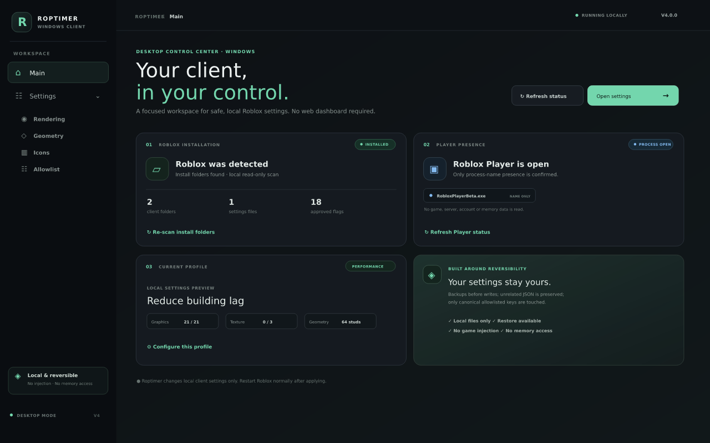
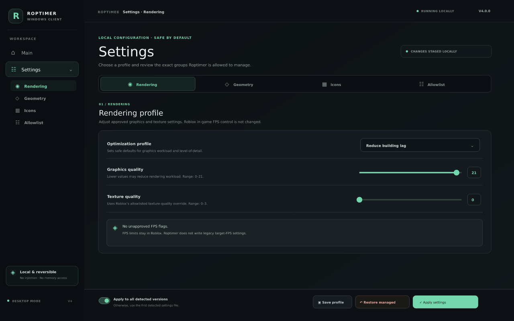

# Roptimer Hub V4

**A single, lightweight Rust + Tauri v2 Windows client and a glowing Three.js website for safe, reversible Roblox performance settings.**

`V4` rebuilds the desktop app in **Rust + Tauri v2** and ships it as one small
Windows 64-bit `.exe` that uses the WebView2 runtime already on Windows 10/11.
On **first launch it detects whether Roblox is installed** (read-only). The
website and the app share one UI whose main tab is the **Windows-only Client**,
showing the **18 Roblox-allowlisted FastFlags** in Geometry, Rendering, and User
Interface — each with what it improves.

> **GitHub Pages is fixed and working.** The live site is served from the
> generated root `index.html` (legacy `main /` source). The Three.js scene now
> uses **vendored, relative ES-module imports** — no CDN, no import map — so it
> loads offline and on GitHub Pages. `python3 build_website.py --check` validates
> the whole thing.

---

## Quick links

| | |
| --- | --- |
| **Live website** | <https://gefrus112.github.io/robloxclinetbooster/> |
| **Windows 64-bit exe (Rust + Tauri, V4)** | [Roptimer-Rust-x64.exe](https://github.com/gefrus112/robloxclinetbooster/releases/download/v4.0.0-windows-rust/Roptimer-Rust-x64.exe) · [release](https://github.com/gefrus112/robloxclinetbooster/releases/tag/v4.0.0-windows-rust) |
| **Windows .NET EXE (legacy)** | [v3.0.0-windows](https://github.com/gefrus112/robloxclinetbooster/releases/tag/v3.0.0-windows) |
| **macOS companion (legacy)** | [v3.1.0-mac](https://github.com/gefrus112/robloxclinetbooster/releases/tag/v3.1.0-mac) |
| **Rust + Tauri guide** | [`docs/RUST_TAURI.md`](docs/RUST_TAURI.md) · [`rust/README.md`](rust/README.md) |
| **FastFlag allowlist** | [`docs/FASTFLAG_ALLOWLIST.md`](docs/FASTFLAG_ALLOWLIST.md) · [`fastflags-allowlist.json`](fastflags-allowlist.json) |
| **Pages troubleshooting** | [`docs/PAGES.md`](docs/PAGES.md) |
| **CLI / how it works** | [`docs/CLI.md`](docs/CLI.md) · [`docs/HOW_IT_WORKS.md`](docs/HOW_IT_WORKS.md) |

---

## Windows x64 desktop app previews (V4)

The Rust + Tauri `.exe` now has a **purpose-built desktop interface**, separate
from the GitHub Pages website. It does not reuse the website UI, Three.js scene,
CSS, or scripts. These PNGs are illustrative previews—not screenshots captured
from a running Windows executable—and example counts are shown.







The app starts with its own loading screen, then opens **Main** plus a grouped
**Settings** area with **Rendering**, **Geometry**, **Icons**, and **Allowlist**
sections. Rendering and geometry controls use the Rust allowlist-backed settings commands. The Icons section
customizes only Roptimer's local interface (icon weight and accent); it does not
change Roblox icons or game assets. Settings can be previewed, saved as a local
profile, applied with a backup, or restored.

> **Current V4 scope:** the Main page detects installed Roblox versions and
> local settings files. Its live status card checks only whether
> `RobloxPlayerBeta.exe` appears in the Windows process list; this reports that
> the Player process is open, not that an experience is actively loaded. It
> does not read command-line arguments, game title/thumbnail, server address or
> ID, account data, or memory. The app does not overlay or replace Roblox's
> in-game menu, and it does not launch Roblox; restart it normally after
> applying. The separate legacy Boost CLI has an optional `bootstrap --launch`
> command ([CLI guide](docs/CLI.md)).

---

## V4 highlights

### Rust + Tauri v2 single-file Windows client

- `Roptimer-Rust-x64.exe` — one lightweight executable, no Electron/Chromium
  bundle, no .NET runtime, no Node at runtime (uses system WebView2).
- **Detects Roblox on first launch** by scanning standard Windows version
  folders — read-only, no process attach, no memory reads, no launching Roblox.
  The result appears on the Main page with a Re-scan button.
- Live status checks at startup and every 10 seconds whether
  `RobloxPlayerBeta.exe` appears in the Windows process list; no command line,
  game/session details, thumbnail, server ID, or address is read.
- Main plus grouped Settings tabs for Rendering, Geometry, Icons, and
  Allowlist. The desktop interface is independent from the website and uses no
  website CSS, JavaScript, or Three.js bundle.
- Safe `apply_settings` / `restore_settings` Rust commands: allowlisted keys
  only, timestamped backups, unrelated keys preserved. See
  [`docs/RUST_TAURI.md`](docs/RUST_TAURI.md).

> The user also suggested **Go + Wails** as an alternative. The `web/` frontend
> is framework-agnostic and can be reused by a Wails `embed.FS` build.

### New glowing website layout (Three.js)

- New near-black **nebula** layout with a vendored Three.js 0.169.0 scene:
  glowing shield, orbiting rings, particles, and UnrealBloom — all offline.
- **Main tab = Client** (Windows-only). Then Allowlist, Downloads, Docs.
- The **allowlist** (Geometry / Rendering / User Interface) is server-rendered
  into the HTML with a "what it improves" note per flag, so it is visible even
  without JavaScript.
- Command palette, cursor glow, scroll reveals, reduced-motion + focus mode,
  custom 404, manifest, robots.txt, sitemap. **No green neon dots.**

### Windows-only allowlist / not for Mac

The Client tab and its FastFlag allowlist manager are **Windows-only**. The
macOS companion is a separate legacy Python/Tkinter tool and does not include
this feature. See [`docs/MAC.md`](docs/MAC.md).

---

## The 18 Roblox-allowlisted FastFlags

Stored in [`fastflags-allowlist.json`](fastflags-allowlist.json) — the single
source of truth used by the Rust client, the website, the .NET core, and the
Python/CLI tools.

- **Geometry (4):** CSG level-of-detail switching distances — safe "reduce
  building lag" (LOD), never deletes buildings.
- **Rendering (13):** texture quality/override, MSAA, DPI scale, D3D11/Vulkan/
  OpenGL preference, gray sky, voxelizer pause, FRM quality level, grass
  distance.
- **User Interface (1):** reduced grass motion.

Each flag now has a `flagFeatures` entry (feature name, value hint, what it
improves); each category has a `categoryDescriptions` entry. The legacy
`DFIntTaskSchedulerTargetFps` is tracked separately and is **not** written.
See [`docs/FASTFLAG_ALLOWLIST.md`](docs/FASTFLAG_ALLOWLIST.md).

---

## Safety boundaries (unchanged)

Roptimer is a **performance tool, not a hacking toolbox**. It uses only local,
reversible `ClientAppSettings.json` writes with timestamped backups, preserves
unrelated keys, restores managed keys, and checks Roblox installation metadata
plus the Roblox Player process name only (no process handles or command lines).

**Never:** DLL injection, process hooks, memory reads/writes, executable
patching, account-data extraction, telemetry/Crashpad/Backtrace disabling,
screenshot/report disabling, anti-cheat bypass, gameplay automation, fullbright/
x-ray, building removal, executor APIs, `loadstring`, remote exploit hubs, or
game script execution. "Reduce building lag" = safe LOD/texture/grass/graphics
reduction. The Script Hub is a **local UI/documentation preview only**.

---

## Build & validate

```bash
# Website (generates web/index.html + root index.html fallback)
python3 build_website.py
python3 build_website.py --check

# Downloads / packages + sync allowlist + Tauri frontend
python3 build_downloads.py

# Rust + Tauri frontend + Windows exe
python3 build_tauri_frontend.py
python3 build_tauri_frontend.py --check
cd rust/src-tauri && cargo build --release

# Self-tests
python3 roblox_fps_optimizer.py --self-test
python3 roptimer_hud.py --self-test
```

### CI workflows

| Workflow | Purpose |
| --- | --- |
| `build-rust-tauri.yml` | Build the single-file Windows x64 exe on `windows-latest`, publish release asset |
| `build-windows.yml` | Legacy .NET 8 WPF build |
| `build-macos.yml` | Legacy macOS companion build |
| `deploy-pages.yml` | Regenerate + validate the GitHub Pages site |

---

## Project layout

```
fastflags-allowlist.json     canonical 18-flag allowlist + feature descriptions
feature-status.json          implemented / legacy / rejected feature catalog
web/                         generated GitHub Pages website only
  index.template.html        V4 website layout (Client main tab)
  assets/nebula.*            website CSS + interactions
  assets/three-scene.js      website-only vendored Three.js scene
rust/                        Rust + Tauri v2 Windows desktop app
  desktop-ui/                standalone Main + grouped Settings interface
  src-tauri/                 Rust crate, Tauri config + commands
    src/session.rs           process-name-only Roblox Player status check
  frontend/                  GENERATED from rust/desktop-ui (do not edit)
build_website.py             website generator + validator
build_tauri_frontend.py      assembles independent Tauri UI from rust/desktop-ui
build_downloads.py           packages, docs, allowlist sync
dotnet/                      legacy C#/.NET 8 app + Boost CLI
roblox_fps_optimizer.py      legacy cross-platform Python optimizer
roptimer_hud.py              legacy session HUD
docs/                        all guides
```
