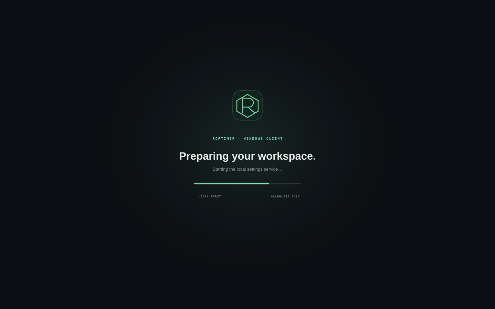
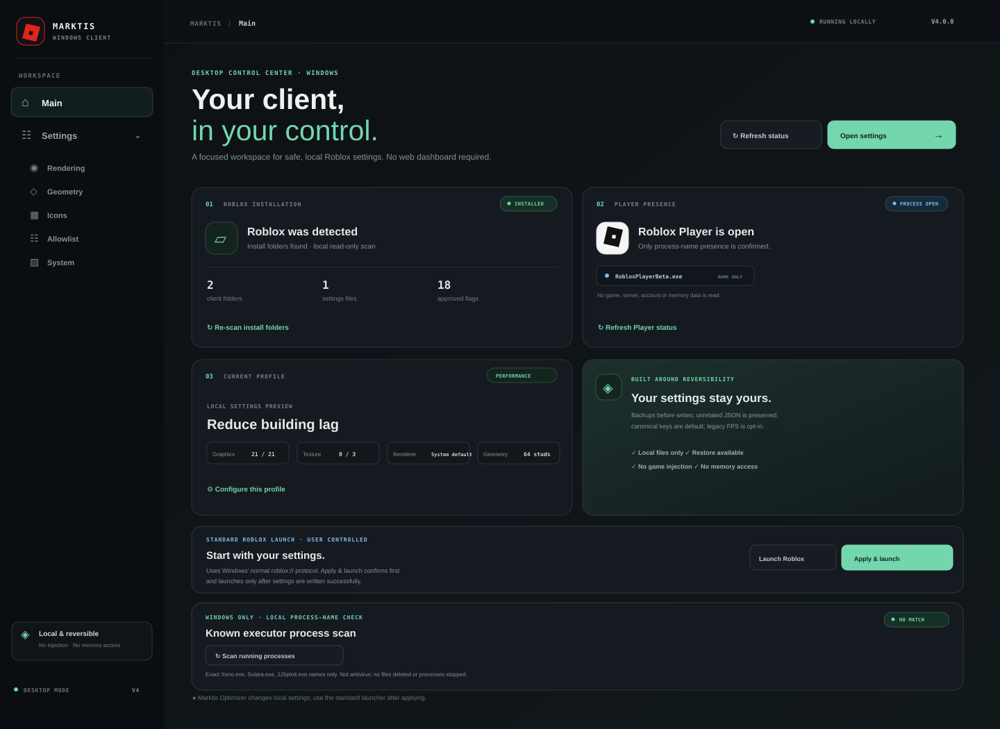
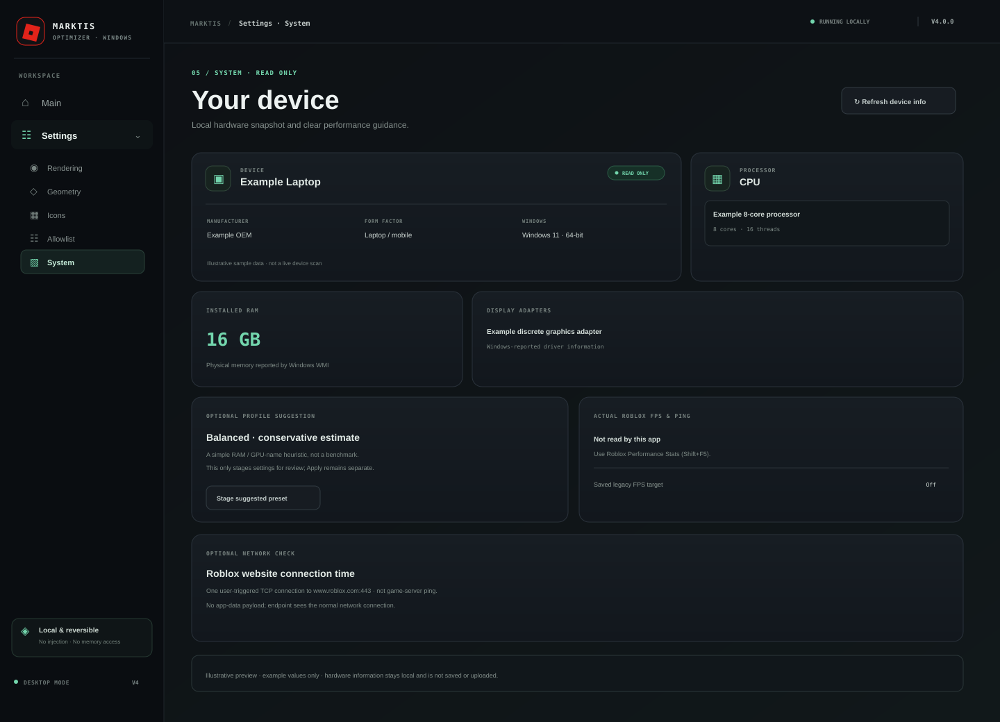
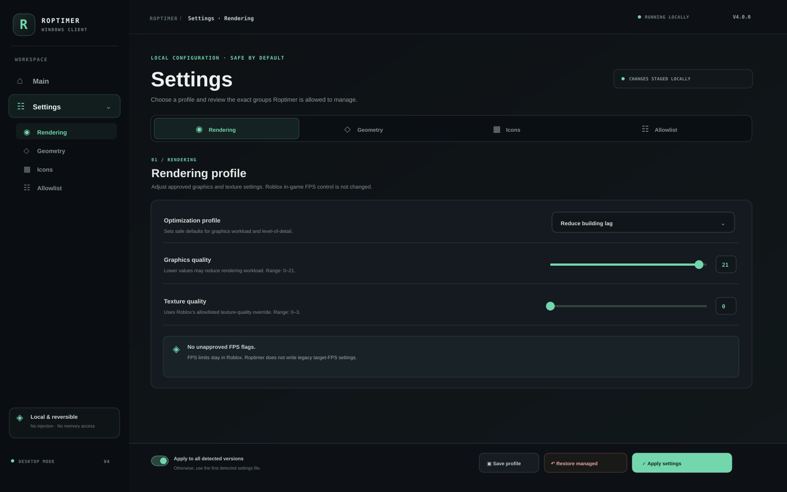
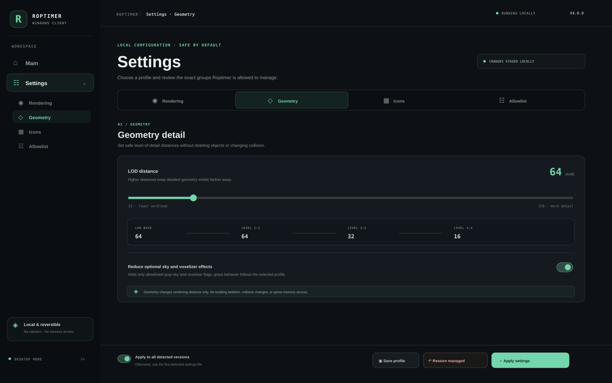
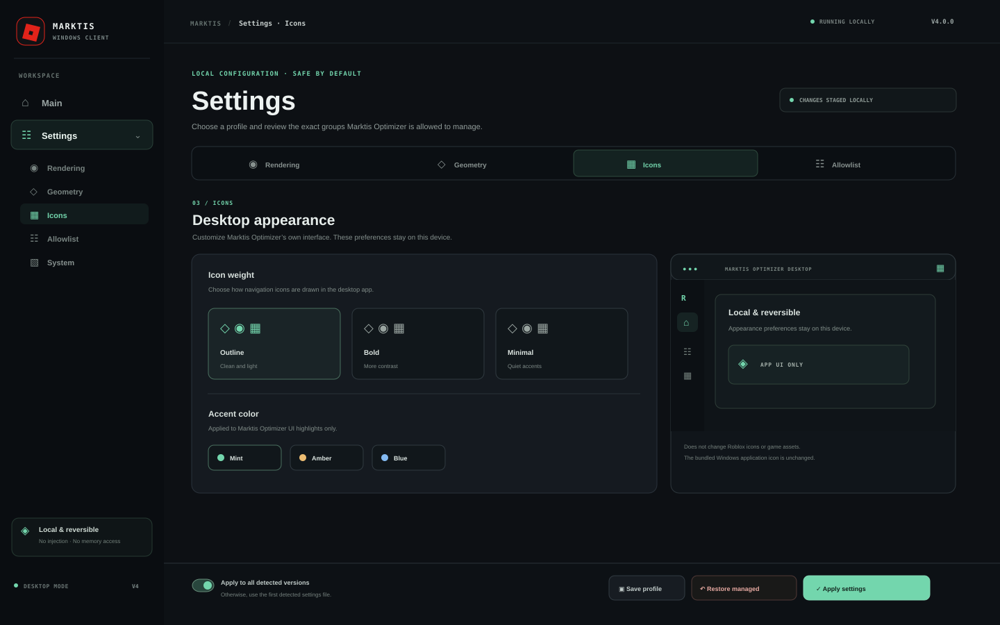
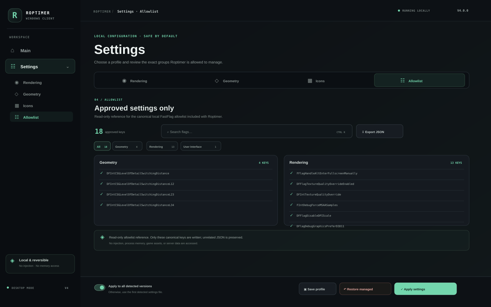

# Marktis Optimizer

**A safe, reversible Roblox settings manager with a Rust + Tauri Windows app, an optional Electron build, and a fast CSS-only website.**

`V4` ships the primary desktop app as a **guided x64 setup wizard** for Rust +
Tauri v2, using the Windows WebView2 runtime (the installer bootstraps it if
missing). An optional Electron Windows build is available as a separate
installer wizard.
On **first launch it detects whether Roblox is installed** (read-only). The
standalone desktop app has its own **Main** page and grouped **Settings** area
for **Rendering**, **Geometry**, **Icons**, **Allowlist**, **Security**,
**VPN**, **System**, and **Notifications**. The Security tab links to Windows Security
for Defender scans and remediation; the VPN tab integrates the official WireGuard
Windows client with a user-supplied provider profile (the app is not a VPN provider).
The System tab displays read-only local hardware and Roblox client status. The website has a separate interface and does not bundle the
desktop UI. A custom red tilted-square mark nods to classic Roblox-era
iconography without using Roblox’s official application logo.

> **GitHub Pages is fixed and working.** The live site is served from the
> generated root `index.html` (legacy `main /` source). The website uses a
> static CSS backdrop; the Three.js/WebGL scene was removed to reduce rendering
> load. `python3 build_website.py --check` verifies the site does not reference
> Three.js runtime assets.

---

## Quick links

| | |
| --- | --- |
| **Live website** | <https://gefrus112.github.io/marktisoptimizer/> |
| **Windows setup wizard (Rust + Tauri, V4)** | [Marktis-Optimizer-Rust-Setup-x64.exe](https://github.com/gefrus112/marktisoptimizer/releases/download/v4.0.0-windows-rust/Marktis-Optimizer-Rust-Setup-x64.exe) · [release](https://github.com/gefrus112/marktisoptimizer/releases/tag/v4.0.0-windows-rust) |
| **Optional Electron setup wizard** | [Build artifacts in GitHub Actions](https://github.com/gefrus112/marktisoptimizer/actions/workflows/build-electron.yml) |
| **Windows .NET EXE (legacy)** | [v3.0.0-windows](https://github.com/gefrus112/marktisoptimizer/releases/tag/v3.0.0-windows) |
| **macOS companion (legacy)** | [v3.1.0-mac](https://github.com/gefrus112/marktisoptimizer/releases/tag/v3.1.0-mac) |
| **Rust + Tauri guide** | [`docs/RUST_TAURI.md`](docs/RUST_TAURI.md) · [`rust/README.md`](rust/README.md) |
| **FastFlag allowlist** | [`docs/FASTFLAG_ALLOWLIST.md`](docs/FASTFLAG_ALLOWLIST.md) · [`fastflags-allowlist.json`](fastflags-allowlist.json) |
| **Pages troubleshooting** | [`docs/PAGES.md`](docs/PAGES.md) |
| **Safe feature roadmap** | [`docs/ROADMAP.md`](docs/ROADMAP.md) |
| **CLI / how it works** | [`docs/CLI.md`](docs/CLI.md) · [`docs/HOW_IT_WORKS.md`](docs/HOW_IT_WORKS.md) |

---

## Quick start — Windows

1. Download the recommended [Rust + Tauri setup wizard](https://github.com/gefrus112/marktisoptimizer/releases/tag/v4.0.0-windows-rust). The optional Electron setup is a separate build.
2. On launch, a read-only storage prompt shows free, used, and total space for
   fixed local drives. It flags drives below 10 GB free or 5% free; you can
   continue or exit, and the app never deletes files. It also checks the
   standard Roblox install folders **read-only**. Detection does not apply or
   change settings.
3. Review a preset and the selected settings. Applying requires your
   confirmation and creates a timestamped local backup; unrelated JSON keys
   are preserved.
4. Use **Restore** in the app to put managed settings back from the backup.
   For actual game FPS and experience ping, open Roblox Performance Stats with
   **Shift+F5**; the app does not read those live game values. Record them
   manually in the local before/after journal, and press **F5** to refresh only
   local install, Player-process, hardware, and safety status.

> Presets only adjust selected, allowlisted settings. They cannot guarantee higher FPS, eliminate stutter, or reduce game-server latency on every device.

## Windows x64 desktop app previews (V4)

The Rust + Tauri and optional Electron builds use a **purpose-built desktop
interface**, separate from the GitHub Pages website. They do not reuse the
website UI, CSS, or scripts. These SVG/PNG previews are illustrative—not screenshots
captured from a running Windows executable—and example counts are shown.















The app starts with its own loading screen, then opens **Main** plus grouped
**Settings** sections for **Rendering**, **Geometry**, **Icons**, **Allowlist**,
**Security**, **VPN**, **System**, and **Notifications**. Rendering includes Max performance, Balanced,
and High quality presets plus adjustable graphics/texture quality and
allowlisted renderer preferences. Max performance lowers selected detail but
cannot guarantee lag-free play or increase hardware limits. Presets only stage
local values; applying them still requires confirmation and creates a backup.
The Rendering page includes an on-device library for up to 12 named setups, with
validated JSON import/export. Loading a saved setup only stages values in the UI;
applying still requires confirmation and creates a backup. The experimental
legacy FPS target remains off by default and may be ignored by Roblox. The Icons
page customizes only the app's local interface, not Roblox icons or game assets.
Its theme gallery currently bundles 10 original anime illustrations with
matching UI accent colors; the remaining 30 requested images are pending
generation. Themes stay on-device.

The **Notifications** tab offers a local in-app activity center for Player
process changes, known process-name matches, settings apply/restore, and low
storage. Notifications default off; event preferences and up to 50 history
items stay in local app storage. Desktop toasts are optional and are attempted
only after the user explicitly requests OS/WebView permission. If native alerts
are unsupported or denied, the in-app center remains available.

The Main page also checks exact running process names `Xeno.exe`, `Solara.exe`,
`JJSploit.exe`, and `Delta.exe` on-device at startup, every 30 seconds, and on
request. A match can appear in the local notification center; an optional OS
toast requires an explicit permission request and enabled notification settings.
The **Security** settings tab and Main safety panel open Windows Security. There,
choose **Virus & threat protection → Quick scan**, or **Scan options** for a Full
or Custom scan; review detections in **Protection history**. Microsoft Defender
performs file scanning and controls any quarantine/remediation under Windows'
settings. Marktis does not inspect file contents, remove threats, or run a custom
antivirus engine. The local executor-name check is **not antivirus**, and a name
match is not proof of malware. Real-time/cloud protection, ransomware controls,
web/phishing protection (SmartScreen), firewall, and updates are Windows-managed;
check their actual state
in Windows Security. The VPN tab uses the official WireGuard for Windows client
with a provider-supplied `.conf` profile. Windows requests administrator approval;
the profile is encrypted locally, and the tunnel follows the provider's routes and
DNS. After setup the service stays active when Marktis closes and may remain after
uninstall; disconnect and remove the profile before uninstalling. It is set not
to auto-start after a Windows restart. The app supplies no VPN service, server,
subscription, or credentials, and cannot guarantee a working tunnel or lower ping.
No custom password manager or dark-web-monitoring engine is included.

> **Current V4 scope:** the Main page detects installed Roblox versions and
> local settings files. Its live status card checks only whether
> `RobloxPlayerBeta.exe` appears in the Windows process list; this reports that
> the Player process is open, not that an experience is actively loaded. The
> Player card includes an approximate stopwatch from the first time this app
> observes `RobloxPlayerBeta.exe`; it resets when the process is not detected,
> status becomes unavailable, or the app closes. It is not game/session time.
> The app does not read command-line arguments, game title/thumbnail, server
> address or ID, account data, or memory, and does not overlay or replace Roblox's
> in-game menu. Its normal launcher uses the fixed standard `roblox://`
> protocol; Apply & launch asks for confirmation and launches only after settings
> are written successfully. A manual server-rejoin action accepts a user-provided
> Place ID and Job ID, but never discovers those values from a running game. The
> separate legacy Boost CLI also has an optional `bootstrap --launch` command
> ([CLI guide](docs/CLI.md)).

Settings files can be written while Roblox Player is open, but the app does not
modify the live game. The current session may ignore or overwrite those values;
restart Roblox after the session to load them.

The Main page's **F5 Quick Status** refreshes only safe local install,
Player-process, hardware, and local safety information. It never reads the game
thumbnail/ID, server, player count, exact session duration, or account data, and
cannot automatically rejoin the running session. The manual **Rejoin a specific
server** control accepts a numeric Place ID plus a UUID Job ID supplied by the
user, stores those IDs only on-device, and asks Roblox to join that target using
the normal protocol. It is not guaranteed if the server is full, private,
closed, or unavailable. A manual before/after journal stores only
FPS and experience-ping values that the user reads from Roblox `Shift+F5` and
enters. The optional Roblox profile shortcut takes a numeric User ID and opens
the fixed official public page in the system browser; no login, cookies, or
profile scraping are used.

The new **System** tab reads laptop/model, CPU, RAM, display adapters, physical
drives and volume space from Windows using a read-only WMI query. It also shows
standard Roblox Player/Studio folders and the local process-name scan. A
hardware-based profile suggestion is only a rough heuristic; it stages settings
for review and does not benchmark or automatically tune the device. The System
tab can open Windows Advanced Graphics settings so you can choose Roblox’s GPU;
HAGS stays under Windows/driver control. The app does not silently delete cache
or temp files, edit fullscreen/priority registry values, clear standby memory,
force restore points, or replace Roblox assets. WireGuard networking is separate:
the official client applies only the provider's imported DNS/routes after explicit
confirmation. The optimizer does not invent routes or offer app-controlled DNS/MTU
tuning.
Actual in-game FPS and server ping are not read by the app—use Roblox
Performance Stats with `Shift+F5`. The optional one-shot `www.roblox.com:443` TCP measurement is
website connection time, not game ping; it sends no app-data payload, and the
endpoint sees the normal network connection.

---

## V4 highlights

### Rust + Tauri v2 Windows client (primary)

- `Marktis-Optimizer-Rust-Setup-x64.exe` — guided x64 installer with a selectable install
  folder, a Start Menu shortcut, an optional Desktop shortcut on the finish
  page, and a Windows uninstaller. The installed app uses system WebView2; no
  batch file, .NET runtime, or Node runtime is required.
- **Detects Roblox on first launch** by scanning standard Windows version
  folders — read-only, with no process attach or memory reads. Main-page controls
  launch Roblox through the standard `roblox://` protocol or confirm settings
  then launch. **Get latest app version** opens the official latest-release page;
  users download and install updates manually (there is no self-updater).
- Live status checks at startup and every 10 seconds whether
  `RobloxPlayerBeta.exe` appears in the Windows process list; no command line,
  game/session details, thumbnail, server ID, or address is read.
- Main plus grouped Settings tabs for Rendering, Geometry, Icons, Allowlist,
  Security, VPN, System, and Notifications. The Security tab opens Windows Security
  for user-selected Defender scans; the VPN tab manages an app-named WireGuard
  tunnel from a provider `.conf` profile using the official Windows client,
  machine-scope DPAPI protection, and an administrator prompt. It provides no
  VPN service or server and cannot verify provider handshakes. The System tab
  shows read-only hardware/drive details and official Roblox Player/Studio folders.
  The Notifications tab keeps
  event preferences and history on-device; native desktop alerts require an
  explicit user permission request. The desktop interface is independent from
  the website and bundles no website CSS or JavaScript.
- Safe `apply_settings` / `restore_settings` Rust commands: canonical 18-key
  allowlist by default, timestamped backups, unrelated keys preserved. A
  separate legacy FPS request is opt-in, experimental, and may be ignored by
  Roblox. See [`docs/RUST_TAURI.md`](docs/RUST_TAURI.md).

### Optional Electron Windows client

- `Marktis-Optimizer-Electron-Setup-x64.exe` — separate x64 NSIS setup wizard with install
  folder selection, Start Menu/Desktop shortcuts, and launch-after-setup. No
  batch file is needed. Download it from the latest successful
  [Electron Actions build](https://github.com/gefrus112/marktisoptimizer/actions/workflows/build-electron.yml).
- It shares the standalone desktop UI with the Tauri app but uses an isolated
  Electron main/preload bridge and local Node backend. Chromium/Node ship with
  Electron; no separate Node install or batch file is required. Remote navigation
  and renderer HTTP(S)/WebSocket requests are blocked. A fixed TCP connection-time
  probe is available only after the user requests it; see [`electron/README.md`](electron/README.md).
- The prior portable Rust/Tauri x64 build is no longer the new distribution;
  the Tauri setup wizard is the replacement. The Electron app is an additional
  alternative, not a replacement for Rust/Tauri.

### Lightweight website layout

- Near-black **nebula** layout with static CSS gradients and stars; the
  Three.js/WebGL rendering loop and its 737 KB vendored library were removed.
- Three new overview cards make the local/reversible workflow, the Roblox
  allowlist, and the lightweight design easy to scan before opening a tab.
- **Main tab = Client** (Windows-only). Then Allowlist, Downloads, Docs.
- The homepage detects the browser platform locally and displays a red
  compatibility notice on non-Windows devices; the page does not store or upload
  the detected platform. The Windows installer follows the latest published GitHub release,
  which users download and install manually.
- The **allowlist** (Geometry / Rendering / User Interface) is server-rendered
  into the HTML with a "what it improves" note per flag, so it is visible even
  without JavaScript.
- The scroll indicator is frame-throttled and uses a transform; screenshot
  previews decode lazily. The public website avoids continuous decorative
  animations and broad backdrop blurs, while retaining short hover/reveal
  transitions, `prefers-reduced-motion`, and Focus Mode.
- Command palette, lightweight scroll reveals, reduced-motion + focus mode,
  custom 404, manifest, robots.txt, sitemap. **No green neon dots.** These
  website changes reduce UI work; they do not promise to remove in-game lag.
- The website keeps `assets/nebula.js` for its tabs and settings builder; it is
  ordinary site UI code, not a Roblox client script. There is no `client.js` file.

### Windows-only allowlist / not for Mac

The Client tab and its FastFlag allowlist manager are **Windows-only**. The
macOS companion is a separate legacy Python/Tkinter tool and does not include
this feature. See [`docs/MAC.md`](docs/MAC.md).

### Automatic hardware tuning and traffic shaping — not included

The System tab reports hardware read-only; profiles are static, user-selected
local settings. Marktis Optimizer does not measure actual in-game FPS, change
Roblox's internal render scale, force CPU affinity, or optimize routes to Roblox
like a game relay. The separate VPN tab can start a user-configured WireGuard
tunnel, whose routes are determined by the provider's `.conf` file and may carry
all internet traffic; it does not promise lower ping. Its optional website TCP
probe is not game-server ping. Use Roblox's own graphics controls and Performance
Stats (`Shift+F5`) for live game measurements.

---

## The 18 Roblox-allowlisted FastFlags

Stored in [`fastflags-allowlist.json`](fastflags-allowlist.json) — the single
source of truth used by the Rust client, the website, the .NET core, and the
Python/CLI tools.

- **Geometry (4):** CSG level-of-detail switching distances — safe "reduce
  building lag" (LOD), never deletes buildings.
- **Rendering (13):** texture quality/override, MSAA, DPI scale, D3D11/Vulkan/
  OpenGL preference, gray sky, voxelizer pause, FRM quality level, grass
  distance.
- **User Interface (1):** reduced grass motion.

Each flag now has a `flagFeatures` entry (feature name, value hint, what it
improves); each category has a `categoryDescriptions` entry. The legacy
`DFIntTaskSchedulerTargetFps` is tracked separately, stays off by default, and
may be written only as an experimental opt-in request; Roblox may ignore it.
See [`docs/FASTFLAG_ALLOWLIST.md`](docs/FASTFLAG_ALLOWLIST.md).

---

## Safety boundaries and scan scope

Marktis Optimizer is a **performance tool, not a hacking toolbox**. It uses local
`ClientAppSettings.json` writes with timestamped backups and preserves unrelated
keys. The canonical 18-key allowlist is the default; one experimental legacy
FPS target is separate, off by default, and may be ignored by Roblox. The Player
status and executor check inspect process image names only; they do not open
process handles or read paths, command lines, account data, game state, or
memory. The executor check is a limited name match—not antivirus—and all alerts
stay in the app. Marktis Optimizer never terminates a process or deletes software; users
review matches through Windows Settings or Windows Security.

**Not included:** guarantees of an FPS unlock or universal lag removal,
arbitrary hidden-flag editors, Direct3D 12 (not on the canonical allowlist),
asset preloading or game-asset mods, Roblox in-game menu changes, multi-instance
bypasses, ping/network optimization or server-region manipulation, or Discord
Rich Presence. These exceed the app's safe, local-settings scope. The existing
CLI can report/quarantine only old Roblox log/temp files; it does not clean game
assets.

**Never:** DLL injection, process hooks, memory reads/writes, executable
patching, account-data extraction, telemetry/Crashpad/Backtrace disabling,
screenshot/report disabling, anti-cheat bypass, gameplay automation, fullbright/
x-ray, building removal, executor APIs, `loadstring`, remote exploit hubs, or
game script execution. "Reduce building lag" = safe LOD/texture/grass/graphics
reduction. The Script Hub is a **local UI/documentation preview only**.

---

## Build & validate

```bash
# Website (generates web/index.html + root index.html fallback)
python3 build_website.py
python3 build_website.py --check

# Downloads / packages + sync allowlist + Tauri frontend
python3 build_downloads.py

# Rust + Tauri setup wizard (Windows)
python build_tauri_frontend.py
python build_tauri_frontend.py --check
cd rust/src-tauri
cargo install tauri-cli --version "^2" --locked
cargo tauri build --bundles nsis

# Optional Electron setup wizard (Windows, Node.js 22)
cd ../../
python build_tauri_frontend.py
cd electron
npm ci
npm run build:win

# Self-tests
python3 roblox_fps_optimizer.py --self-test
python3 roptimer_hud.py --self-test
```

### CI workflows

| Workflow | Purpose |
| --- | --- |
| `build-rust-tauri.yml` | Build the Rust + Tauri x64 NSIS setup wizard on `windows-latest` |
| `build-electron.yml` | Test and package the optional Electron x64 setup wizard |
| `build-windows.yml` | Legacy .NET 8 WPF build |
| `build-macos.yml` | Legacy macOS companion build |
| `deploy-pages.yml` | Regenerate + validate the GitHub Pages site |

---

## Project layout

```
fastflags-allowlist.json     canonical 18-flag allowlist + feature descriptions
feature-status.json          implemented / legacy / rejected feature catalog
web/                         generated GitHub Pages website only
  index.template.html        V4 website layout (Client main tab)
  assets/nebula.*            website CSS + interactions
electron/                    optional Electron Windows client + NSIS setup wizard
  backend.cjs                local allowlist/settings + name-only scan bridge
  main.cjs / preload.cjs     hardened Electron main and IPC boundary
rust/                        primary Rust + Tauri v2 Windows desktop app
  desktop-ui/                standalone Main + grouped Settings interface
  src-tauri/                 Rust crate, Tauri config + commands
    src/session.rs           process-name-only Roblox Player status check
  frontend/                  GENERATED from rust/desktop-ui (do not edit)
build_website.py             website generator + validator
build_tauri_frontend.py      assembles independent Tauri UI from rust/desktop-ui
build_downloads.py           packages, docs, allowlist sync
dotnet/                      legacy C#/.NET 8 app + Boost CLI
roblox_fps_optimizer.py      legacy cross-platform Python optimizer
roptimer_hud.py              legacy session HUD
docs/                        all guides
```
