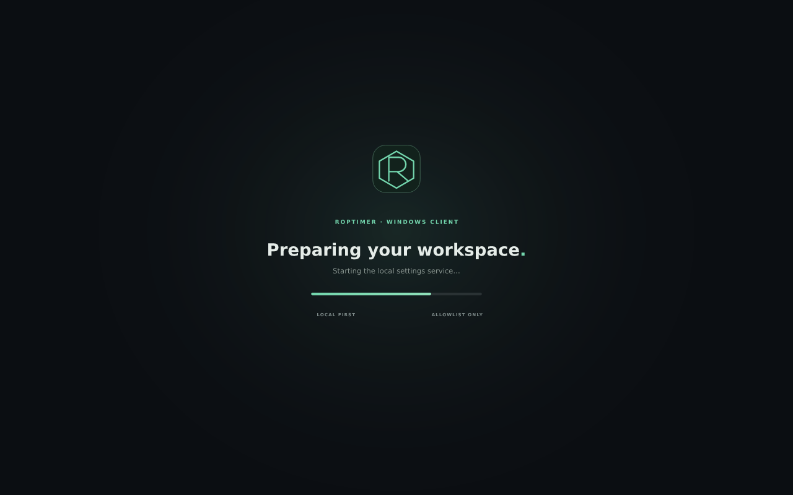
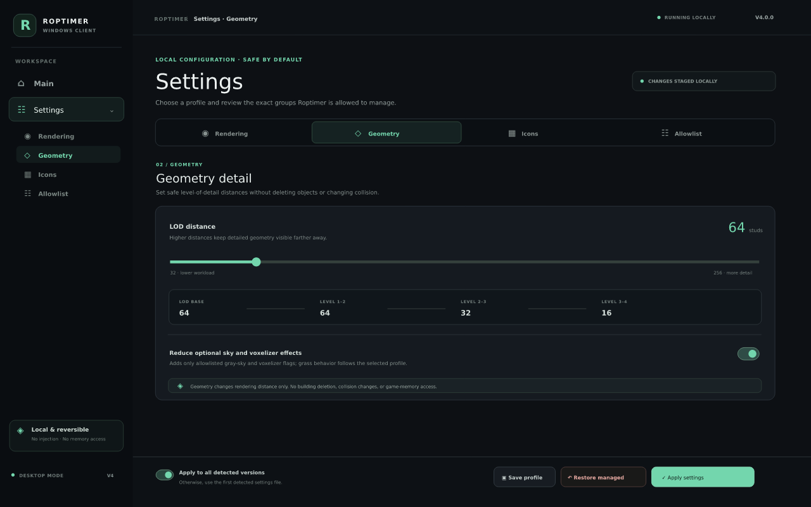
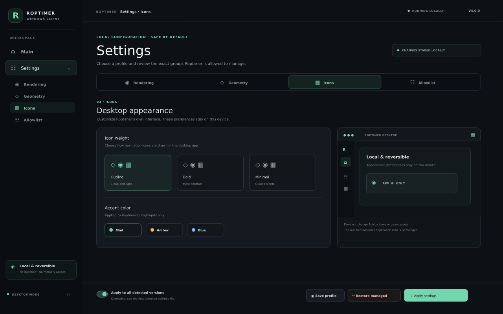
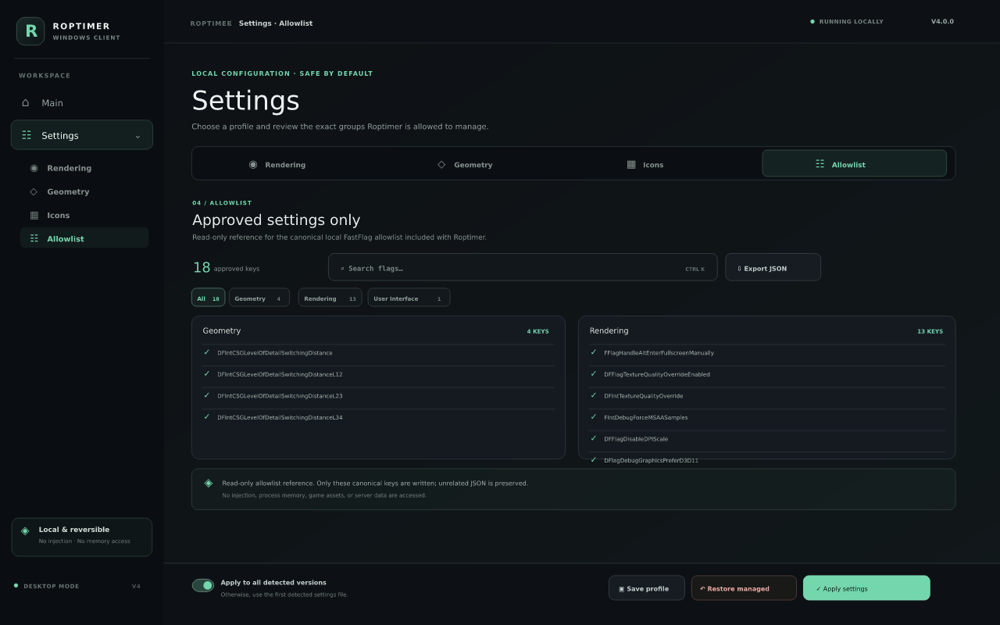

# Roptimer Hub V4

**A safe, reversible Roblox settings manager with a Rust + Tauri Windows app, an optional Electron build, and a fast CSS-only website.**

`V4` ships the primary desktop app as a **guided x64 setup wizard** for Rust +
Tauri v2, using the Windows WebView2 runtime (the installer bootstraps it if
missing). An optional Electron Windows build is available as a separate
installer wizard.
On **first launch it detects whether Roblox is installed** (read-only). The
standalone desktop app has its own **Main** page and grouped **Settings** area
for **Rendering**, **Geometry**, **Icons**, and **Allowlist**. The website has a
separate interface and does not bundle the desktop UI.

> **GitHub Pages is fixed and working.** The live site is served from the
> generated root `index.html` (legacy `main /` source). The website uses a
> static CSS backdrop; the Three.js/WebGL scene was removed to reduce rendering
> load. `python3 build_website.py --check` verifies the site does not reference
> Three.js runtime assets.

---

## Quick links

| | |
| --- | --- |
| **Live website** | <https://gefrus112.github.io/robloxclinetbooster/> |
| **Windows setup wizard (Rust + Tauri, V4)** | [Roptimer-Rust-Setup-x64.exe](https://github.com/gefrus112/robloxclinetbooster/releases/download/v4.0.0-windows-rust/Roptimer-Rust-Setup-x64.exe) · [release](https://github.com/gefrus112/robloxclinetbooster/releases/tag/v4.0.0-windows-rust) |
| **Optional Electron setup wizard** | [Build artifacts in GitHub Actions](https://github.com/gefrus112/robloxclinetbooster/actions/workflows/build-electron.yml) |
| **Windows .NET EXE (legacy)** | [v3.0.0-windows](https://github.com/gefrus112/robloxclinetbooster/releases/tag/v3.0.0-windows) |
| **macOS companion (legacy)** | [v3.1.0-mac](https://github.com/gefrus112/robloxclinetbooster/releases/tag/v3.1.0-mac) |
| **Rust + Tauri guide** | [`docs/RUST_TAURI.md`](docs/RUST_TAURI.md) · [`rust/README.md`](rust/README.md) |
| **FastFlag allowlist** | [`docs/FASTFLAG_ALLOWLIST.md`](docs/FASTFLAG_ALLOWLIST.md) · [`fastflags-allowlist.json`](fastflags-allowlist.json) |
| **Pages troubleshooting** | [`docs/PAGES.md`](docs/PAGES.md) |
| **CLI / how it works** | [`docs/CLI.md`](docs/CLI.md) · [`docs/HOW_IT_WORKS.md`](docs/HOW_IT_WORKS.md) |

---

## Windows x64 desktop app previews (V4)

The Rust + Tauri and optional Electron builds use a **purpose-built desktop
interface**, separate from the GitHub Pages website. They do not reuse the
website UI, CSS, or scripts. These SVG/PNG previews are illustrative—not screenshots
captured from a running Windows executable—and example counts are shown.










The app starts with its own loading screen, then opens **Main** plus a grouped
**Settings** area with **Rendering**, **Geometry**, **Icons**, and **Allowlist**
sections. Rendering and geometry controls use the Rust allowlist-backed settings
commands. Rendering includes graphics/texture quality and allowlisted System
default, Direct3D 11, Vulkan, or OpenGL preferences; FPS caps remain controlled
in Roblox. The Icons section customizes only Roptimer's local interface (icon
weight and accent), not Roblox icons or game assets. Settings can be previewed,
saved as a local profile, applied with a backup, or restored.

The Main page also performs a local, name-only check for the exact running
process names `Xeno.exe`, `Solara.exe`, and `JJSploit.exe` at startup, every 30
seconds while open, and on request, with in-app alerts.
It is **not antivirus** and does not inspect paths, command lines, files, or
memory, or send data over the network. On a match, Windows Installed Apps and
Windows Security links let you review it; Roptimer never kills processes or
deletes software automatically.

> **Current V4 scope:** the Main page detects installed Roblox versions and
> local settings files. Its live status card checks only whether
> `RobloxPlayerBeta.exe` appears in the Windows process list; this reports that
> the Player process is open, not that an experience is actively loaded. It
> does not read command-line arguments, game title/thumbnail, server address or
> ID, account data, or memory. The app does not overlay or replace Roblox's
> in-game menu, and it does not launch Roblox; restart it normally after
> applying. The separate legacy Boost CLI has an optional `bootstrap --launch`
> command ([CLI guide](docs/CLI.md)).

---

## V4 highlights

### Rust + Tauri v2 Windows client (primary)

- `Roptimer-Rust-Setup-x64.exe` — guided x64 installer with a selectable install
  folder, Start Menu/Desktop shortcuts, and a Windows uninstaller. The installed
  app uses system WebView2; no batch file, .NET runtime, or Node runtime is
  required.
- **Detects Roblox on first launch** by scanning standard Windows version
  folders — read-only, no process attach, no memory reads, no launching Roblox.
  The result appears on the Main page with a Re-scan button.
- Live status checks at startup and every 10 seconds whether
  `RobloxPlayerBeta.exe` appears in the Windows process list; no command line,
  game/session details, thumbnail, server ID, or address is read.
- Main plus grouped Settings tabs for Rendering, Geometry, Icons, and
  Allowlist. The desktop interface is independent from the website and bundles
  no website CSS or JavaScript.
- Safe `apply_settings` / `restore_settings` Rust commands: allowlisted keys
  only, timestamped backups, unrelated keys preserved. See
  [`docs/RUST_TAURI.md`](docs/RUST_TAURI.md).

### Optional Electron Windows client

- `Roptimer-Electron-Setup-x64.exe` — separate x64 NSIS setup wizard with install
  folder selection, Start Menu/Desktop shortcuts, and launch-after-setup. No
  batch file is needed. Download it from the latest successful
  [Electron Actions build](https://github.com/gefrus112/robloxclinetbooster/actions/workflows/build-electron.yml).
- It shares the standalone desktop UI with the Tauri app but uses an isolated
  Electron main/preload bridge and local Node backend. Chromium/Node ship with
  Electron; no separate Node install or batch file is required. Remote navigation
  and HTTP(S)/WebSocket requests are blocked. See [`electron/README.md`](electron/README.md).
- The prior portable Rust/Tauri x64 build is no longer the new distribution;
  the Tauri setup wizard is the replacement. The Electron app is an additional
  alternative, not a replacement for Rust/Tauri.

### Lightweight website layout

- Near-black **nebula** layout with static CSS gradients and stars; the
  Three.js/WebGL rendering loop and its 737 KB vendored library were removed.
- **Main tab = Client** (Windows-only). Then Allowlist, Downloads, Docs.
- The **allowlist** (Geometry / Rendering / User Interface) is server-rendered
  into the HTML with a "what it improves" note per flag, so it is visible even
  without JavaScript.
- Command palette, lightweight scroll reveals, reduced-motion + focus mode,
  custom 404, manifest, robots.txt, sitemap. **No green neon dots.**
- The website keeps `assets/nebula.js` for its tabs and settings builder; it is
  ordinary site UI code, not a Roblox client script. There is no `client.js` file.

### Windows-only allowlist / not for Mac

The Client tab and its FastFlag allowlist manager are **Windows-only**. The
macOS companion is a separate legacy Python/Tkinter tool and does not include
this feature. See [`docs/MAC.md`](docs/MAC.md).

### Dynamic hardware and network controls — not included

The desktop profiles are static, user-selected local settings. Roptimer does
not monitor in-game FPS/GPU utilization, change Roblox's internal render scale,
force P-core/E-core affinity, or reroute game traffic through a VPN/relay.
Those actions require process-level or system-network changes outside the
allowlisted settings boundary; use Roblox's own graphics controls and Windows'
normal CPU/network scheduling instead.

---

## The 18 Roblox-allowlisted FastFlags

Stored in [`fastflags-allowlist.json`](fastflags-allowlist.json) — the single
source of truth used by the Rust client, the website, the .NET core, and the
Python/CLI tools.

- **Geometry (4):** CSG level-of-detail switching distances — safe "reduce
  building lag" (LOD), never deletes buildings.
- **Rendering (13):** texture quality/override, MSAA, DPI scale, D3D11/Vulkan/
  OpenGL preference, gray sky, voxelizer pause, FRM quality level, grass
  distance.
- **User Interface (1):** reduced grass motion.

Each flag now has a `flagFeatures` entry (feature name, value hint, what it
improves); each category has a `categoryDescriptions` entry. The legacy
`DFIntTaskSchedulerTargetFps` is tracked separately and is **not** written.
See [`docs/FASTFLAG_ALLOWLIST.md`](docs/FASTFLAG_ALLOWLIST.md).

---

## Safety boundaries and scan scope

Roptimer is a **performance tool, not a hacking toolbox**. It uses local,
reversible `ClientAppSettings.json` writes with timestamped backups, preserves
unrelated keys, and manages only the canonical allowlist. The Player status and
executor check inspect process image names only; they do not open process
handles or read paths, command lines, account data, game state, or memory. The
executor check is a limited name match—not antivirus—and all alerts stay in the
app. Roptimer never terminates a process or deletes software; users review
matches through Windows Settings or Windows Security.

**Not included:** unsupported FPS-unlock flags, arbitrary hidden-flag editors,
Direct3D 12 (not on the canonical allowlist), asset preloading or game-asset
mods, Roblox in-game menu changes, multi-instance bypasses, ping/network
optimization or server-region manipulation, or Discord Rich Presence. These
would exceed the app's safe,
local allowlist scope. The existing CLI can report/quarantine only old Roblox
log/temp files; it does not clean game assets.

**Never:** DLL injection, process hooks, memory reads/writes, executable
patching, account-data extraction, telemetry/Crashpad/Backtrace disabling,
screenshot/report disabling, anti-cheat bypass, gameplay automation, fullbright/
x-ray, building removal, executor APIs, `loadstring`, remote exploit hubs, or
game script execution. "Reduce building lag" = safe LOD/texture/grass/graphics
reduction. The Script Hub is a **local UI/documentation preview only**.

---

## Build & validate

```bash
# Website (generates web/index.html + root index.html fallback)
python3 build_website.py
python3 build_website.py --check

# Downloads / packages + sync allowlist + Tauri frontend
python3 build_downloads.py

# Rust + Tauri setup wizard (Windows)
python build_tauri_frontend.py
python build_tauri_frontend.py --check
cd rust/src-tauri
cargo install tauri-cli --version "^2" --locked
cargo tauri build --bundles nsis

# Optional Electron setup wizard (Windows, Node.js 22)
cd ../../
python build_tauri_frontend.py
cd electron
npm ci
npm run build:win

# Self-tests
python3 roblox_fps_optimizer.py --self-test
python3 roptimer_hud.py --self-test
```

### CI workflows

| Workflow | Purpose |
| --- | --- |
| `build-rust-tauri.yml` | Build the Rust + Tauri x64 NSIS setup wizard on `windows-latest` |
| `build-electron.yml` | Test and package the optional Electron x64 setup wizard |
| `build-windows.yml` | Legacy .NET 8 WPF build |
| `build-macos.yml` | Legacy macOS companion build |
| `deploy-pages.yml` | Regenerate + validate the GitHub Pages site |

---

## Project layout

```
fastflags-allowlist.json     canonical 18-flag allowlist + feature descriptions
feature-status.json          implemented / legacy / rejected feature catalog
web/                         generated GitHub Pages website only
  index.template.html        V4 website layout (Client main tab)
  assets/nebula.*            website CSS + interactions
electron/                    optional Electron Windows client + NSIS setup wizard
  backend.cjs                local allowlist/settings + name-only scan bridge
  main.cjs / preload.cjs     hardened Electron main and IPC boundary
rust/                        primary Rust + Tauri v2 Windows desktop app
  desktop-ui/                standalone Main + grouped Settings interface
  src-tauri/                 Rust crate, Tauri config + commands
    src/session.rs           process-name-only Roblox Player status check
  frontend/                  GENERATED from rust/desktop-ui (do not edit)
build_website.py             website generator + validator
build_tauri_frontend.py      assembles independent Tauri UI from rust/desktop-ui
build_downloads.py           packages, docs, allowlist sync
dotnet/                      legacy C#/.NET 8 app + Boost CLI
roblox_fps_optimizer.py      legacy cross-platform Python optimizer
roptimer_hud.py              legacy session HUD
docs/                        all guides
```
